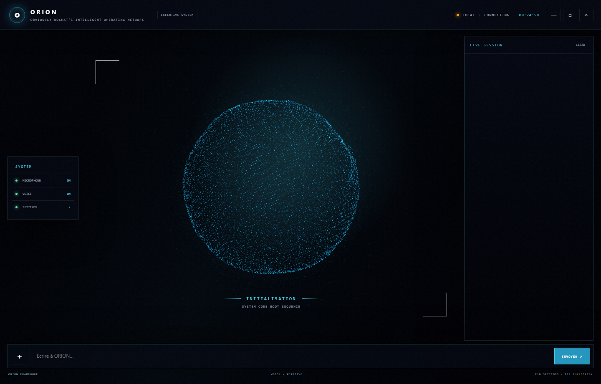
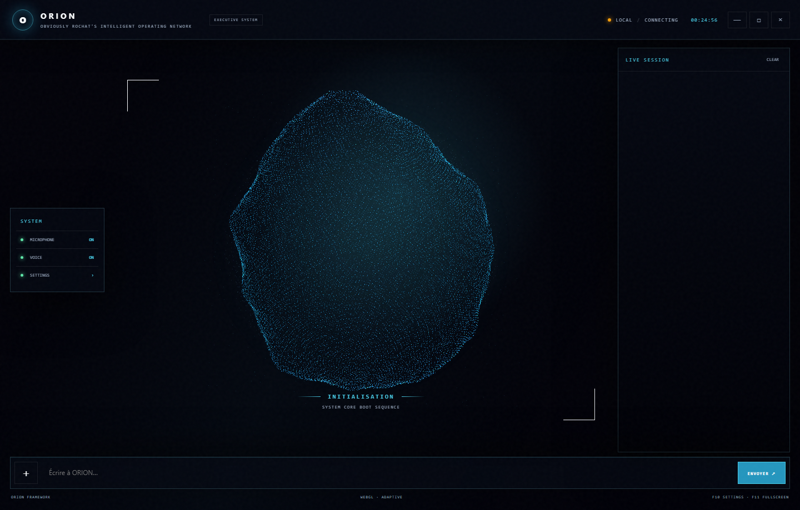
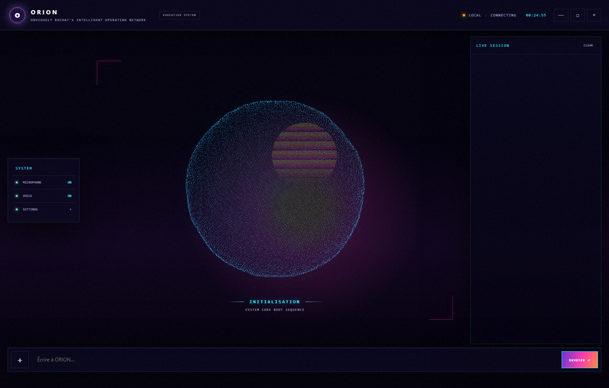
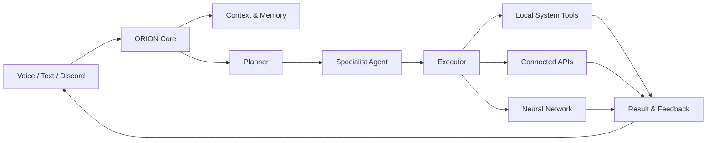
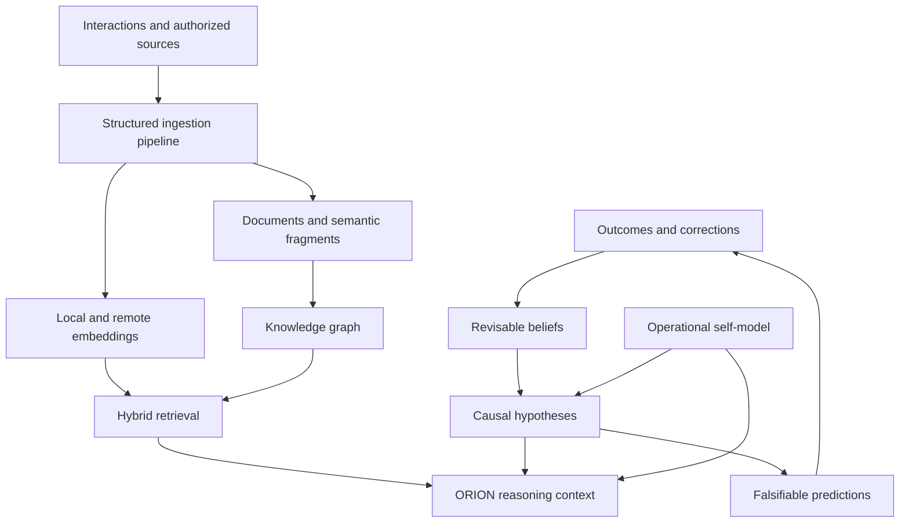

<div align="center">


# ORION

### Obviously Rochat's Intelligent Operating Network

**A proactive AI operating network built to understand intent, coordinate specialized tools and turn requests into real actions.**

[](#project-status)
[](#project-status)
[](#requirements)
[](#requirements)
[](#project-status)

<div align="center">

## Explore ORION online

**Discover the official ORION website, its vision, capabilities and evolving ecosystem.**

[](https://nuppii.github.io/ORION-WEB/)

### [nuppii.github.io/ORION-WEB](https://nuppii.github.io/ORION-WEB/)

</div>

---

> [!IMPORTANT]
> **ORION is an experimental project under active development. It is not production-ready and is not yet ready for commercialization.** Features, interfaces, installation steps and internal architecture may change without notice. Do not rely on ORION for critical, sensitive or irreversible operations.

</div>

---

## Table of contents

- [Vision](#vision)
- [Project status](#project-status)
- [Desktop experience](#desktop-experience)
- [What ORION can do](#what-orion-can-do)
- [How it works](#how-it-works)
- [Neural Network](#neural-network)
- [Architecture](#architecture)
- [Technology stack](#technology-stack)
- [Requirements](#requirements)
- [Installation](#installation)
- [Configuration](#configuration)
- [Running ORION](#running-orion)
- [Optional services](#optional-services)
- [Project structure](#project-structure)
- [Security and privacy](#security-and-privacy)
- [Known limitations](#known-limitations)
- [Roadmap](#roadmap)
- [Contributing](#contributing)
- [Usage and ownership](#usage-and-ownership)
- [Disclaimer](#disclaimer)

---

## Vision

ORION is an attempt to move beyond the traditional question-and-answer assistant.

Its purpose is to become an intelligent operational layer between a person and their digital environment: a system capable of understanding a goal, selecting the appropriate capabilities, coordinating multi-step workflows, interacting with local applications and connected services, and reporting the result clearly.

The long-term vision is an assistant that feels less like a chatbot and more like a dependable operating network:

```text
User intent
    ↓
Context and memory
    ↓
Planning and specialist selection
    ↓
Tool orchestration and controlled execution
    ↓
Result, feedback and retained knowledge
```

ORION stands for **Obviously Rochat's Intelligent Operating Network**.

---

## Project status

| Area | Current state |
|---|---|
| Development | Active and experimental |
| Public API stability | Not guaranteed |
| User interface | Functional, still evolving |
| Installation | Developer-oriented |
| Automated testing | Partial |
| Cross-platform support | Experimental; Windows is the primary target |
| Security hardening | In progress |
| Production readiness | Not ready |
| Commercial readiness | **Not ready for commercialization** |

ORION is currently a research, learning and productivity project. Some modules work end-to-end, while others are prototypes, depend on third-party services or still require manual configuration.

The repository should therefore be treated as a **development snapshot**, not as a finished consumer product. No availability, reliability, compatibility or data-preservation guarantee is provided at this stage.

---

## Desktop experience

ORION now ships with a compact, native Windows shell built with **WebView2**, local
HTML/CSS and an offline Three.js renderer. The interface keeps the operational
conversation visible while a GPU-driven particle core communicates ORION's live
state: initialization, listening, reasoning, speaking, reconnection and errors.



### Audio-reactive particle core

The central sphere is more than a decorative animation. Gemini Live PCM remains
untouched on its way to the selected Windows audio device, while a separate Hann
FFT analysis feeds the renderer with RMS energy, bass, low-mid, mid, treble and
transient envelopes. A custom vertex shader turns those bands into localized,
NCS-inspired surface movement instead of a uniform scale effect.



- 12,000 to 30,000 Fibonacci-distributed particles depending on render quality.
- GPU-side multi-octave organic deformation with no per-frame geometry rebuild.
- Strong frequency-aware motion, transient waves and smooth attack/release.
- Pointer-driven local deformation with an elastic return when the cursor leaves.
- Adaptive quality, capped pixel ratio, reduced-motion support and Canvas 2D fallback.
- Five persistent visual themes, including a true cyan/magenta sunset Retrowave mode.

<details>
<summary>Retrowave theme</summary>



</details>

The shell exposes only a narrow, validated Python-to-JavaScript bridge. File
selection, model settings, permissions and window controls are explicit intents;
arbitrary command execution, filesystem access and credentials are not exposed to
the web layer. Set `ORION_LEGACY_UI=1` to force the original Tk interface when
WebView2 is unavailable.

---

## What ORION can do

### Natural interaction

- Real-time voice interaction powered by Gemini.
- Text-based interaction through the desktop interface.
- Multilingual input and response handling.
- Wake, interruption and audio-device management.
- Discord-based text interaction with tool dispatch.

### System and desktop automation

- Open and interact with local applications.
- Perform keyboard, mouse and clipboard operations.
- Manage selected files and desktop workflows.
- Inspect the screen and use visual context.
- Run controlled scripts and multi-step actions.
- Adjust supported computer settings.

> [!WARNING]
> Desktop automation can affect real files, applications and accounts. Review the requested operation before allowing sensitive or destructive actions.

### Planning and orchestration

- Convert a high-level goal into structured execution steps.
- Route tasks to specialized agent profiles.
- Select tools based on intent and context.
- Queue tasks and track their execution state.
- Analyze failures and attempt contextual recovery.
- Re-plan when an initial execution path fails.

### Memory and knowledge

- Store persistent long-term context locally.
- Recall preferences, projects, relationships and notes.
- Maintain a PostgreSQL-backed **Neural Network**.
- Collect authorized sources through a concurrent structured pipeline with canonical URLs,
  semantic chunking, content-hash deduplication, provenance, quality scoring, immediate
  local indexing and background batch-embedding enrichment.
- Link knowledge nodes and explore related information.
- Synchronize legacy long-term memory into the knowledge graph.

### Connected services

Depending on local configuration and account permissions, ORION contains integrations for:

- Google Calendar
- Google Drive, Docs, Sheets and Gmail
- YouTube account operations exposed by official APIs
- Spotify playback and device control
- Discord
- Web search and weather information
- Flight discovery

### Productivity modules

- Local finance dashboard for transactions, assets and cash-flow summaries.
- Financial analysis and planning assistance.
- Reminders and calendar workflows.
- Coding and development assistance.
- Screen processing and visual workflows.
- YouTube transcript and media-related actions.

Not every capability has the same maturity level. Availability can depend on the operating system, API credentials, OAuth scopes, installed applications and third-party service limits.

---

## How it works

At runtime, ORION combines several layers:

1. **Interface layer** — receives voice or text input and presents feedback.
2. **Context layer** — loads configuration, conversation state and persistent memory.
3. **Reasoning layer** — interprets intent and determines whether a direct tool call or a structured plan is appropriate.
4. **Agent layer** — assigns domain-oriented tasks to specialist profiles.
5. **Execution layer** — validates parameters and invokes the selected local or connected tool.
6. **Recovery layer** — captures failures, analyzes errors and can re-plan execution.
7. **Memory layer** — retains useful facts and links durable knowledge when appropriate.



---

## Neural Network

ORION includes a persistent cognitive subsystem called **Neural Network**. It is
more than a note store: it combines several complementary forms of memory and
reasoning while keeping every learned item inspectable.

The Neural Network is **model-provider independent**. Gemini, Ollama and
OpenAI-compatible servers are interchangeable reasoning engines around the same
ORION identity, working memory, causal model, attention policy and learning loop.
Changing the language model does not reset ORION's cognitive architecture.
Every substantive request passes through the Neural Network before its answer,
including direct tool shortcuts, Discord text and typed Gemini Live requests.
Realtime voice sessions receive a bounded persistent neural bootstrap and each
voice turn is recorded as a cognitive cycle. If PostgreSQL is temporarily
unavailable, ORION builds the same envelope locally in degraded mode instead of
silently answering without its cognitive policy.

> [!NOTE]
> The self-model described below is an operational and inspectable representation
> of ORION's identity, capabilities, goals and limits. It is not evidence of
> subjective consciousness or human sentience.

### Cognitive architecture



| Layer | Purpose |
|---|---|
| Semantic memory | Durable facts, documents, projects, preferences and linked concepts |
| Episodic memory | Interactions, corrections, outcomes and failure patterns |
| Knowledge graph | Explicit nodes and weighted relationships |
| Causal model | Revisable cause/effect hypotheses with evidence and contradictions |
| Belief system | Confidence updated from supporting or opposing observations |
| Prediction system | Falsifiable expectations that strengthen or weaken causal hypotheses |
| Self-model | Inspectable identity, architecture, goals, limits and performance state |
| Metacognition | Outcome evaluation, habit detection, consolidation and controlled forgetting |
| Global Workspace | Bounded attention shared identically with every model provider |
| Working memory | Expiring task state kept separate from durable knowledge |

### Fast structured collection

External collection is deliberately restricted to sources explicitly authorized
by the user. The system does not indiscriminately scrape the Internet.

For approved sources, the ingestion pipeline:

1. downloads up to 50 URLs per batch with bounded concurrency;
2. canonicalizes addresses and removes common tracking parameters;
3. removes scripts, navigation and non-informative page chrome;
4. scores source trust, structure and information quality;
5. detects unchanged or duplicate content using SHA-256 fingerprints;
6. divides documents into coherent overlapping semantic fragments;
7. indexes an immediate local 128-dimensional representation;
8. enriches fragments with Gemini embeddings in background batches;
9. records URL, domain, date, trust, quality and authorization provenance;
10. archives obsolete fragments instead of silently destroying history.

The two-stage embedding strategy keeps foreground ingestion responsive: local
vectors are searchable immediately, while remote enrichment improves deep recall
without blocking the ORION interface.

### Hybrid retrieval

Neural Network retrieval combines:

- PostgreSQL full-text search;
- title similarity and query-term coverage;
- fast deterministic local embeddings;
- optional Gemini semantic reranking through `deep` mode;
- confidence, importance, source trust and quality;
- information freshness and provenance;
- result diversification so one document cannot dominate the answer.

Exact recent searches and embeddings are retained in bounded in-process caches.
This improves latency without creating an unbounded RAM consumer.

### Model-independent cognition

Every text request is converted into the same provider-neutral cognitive
envelope before it reaches a language model. The envelope contains:

- the current goal and bounded attention set;
- relevant memories with confidence and provenance;
- operational self-state;
- causal hypotheses and alternative explanations;
- explicit counterfactual tests;
- pending falsifiable predictions;
- uncertainty and authority constraints;
- three decision scenarios for consequential actions: execute, use a safer
  alternative, or do nothing;
- adaptive reasoning effort and contextual humor policy.

Text backends can be selected in **Settings > Provider**. ORION includes native
Gemini and Anthropic Messages adapters, Ollama, and an OpenAI Chat Completions
adapter used by OpenAI, OpenRouter, Mistral, Groq, xAI, DeepSeek, Together,
LM Studio, vLLM and LocalAI. **Custom endpoint** accepts either the OpenAI or
Anthropic wire protocol, so adding a compatible host does not require a code
change. The model name is never restricted to a hard-coded catalogue.

Environment variables can override the interface configuration:

```powershell
# Local Ollama
$env:ORION_TEXT_BACKEND = "ollama"
$env:ORION_TEXT_MODEL = "gemma4:e4b"
$env:ORION_OLLAMA_BASE_URL = "http://localhost:11434"

# Gemini text generation
$env:ORION_TEXT_BACKEND = "gemini"
$env:ORION_TEXT_MODEL = "gemini-3.6-flash"

# LM Studio, vLLM, LocalAI or another OpenAI-compatible server
$env:ORION_TEXT_BACKEND = "openai_compatible"
$env:ORION_TEXT_MODEL = "your-model-name"
$env:ORION_OPENAI_COMPATIBLE_BASE_URL = "http://localhost:1234/v1"
$env:ORION_OPENAI_COMPATIBLE_API_KEY = ""

# Native Anthropic Messages API
$env:ORION_TEXT_BACKEND = "anthropic"
$env:ORION_TEXT_MODEL = "claude-sonnet-4-5"
$env:ANTHROPIC_API_KEY = "your-key"

# Native OpenAI API (the same pattern works with the provider presets)
$env:ORION_TEXT_BACKEND = "openai"
$env:ORION_TEXT_MODEL = "gpt-5.2"
$env:OPENAI_API_KEY = "your-key"
```

`ORION_API_KEY` is the provider-neutral secret override. Provider-specific keys
remain supported. Saved secrets are never returned to the web interface; it only
receives whether a key is configured. Voice remains a separate capability because
real-time audio protocols are not interchangeable with text APIs.

Provider-specific adapters only translate messages and tool calls. They do not
own memory, identity or causal state.

### Security, governance and operations

ORION now separates sensitive credentials from ordinary settings. On Windows,
model and account secrets are encrypted for the current user with DPAPI and
legacy plaintext keys are migrated automatically. The UI receives only a
boolean indicating whether a key is configured.

Code execution through `internal_sandbox` requires Docker and runs in an
ephemeral, read-only container with no network, no Linux capabilities,
`no-new-privileges`, and bounded CPU, memory, process count and execution time.
ORION refuses to fall back to direct host Python execution when isolation is
unavailable.

The Settings screen includes:

- **Model Center**: provider/model discovery, protocol, output-token limit,
  measured latency, usage and model selection;
- **AI budget controls**: monthly USD budget, request quota, and editable input
  and output prices per million tokens for models outside the built-in catalog;
- **Memory Governance**: private mode, retention period, portable export and
  confirmation-token-protected purge scopes;
- **System Health**: live probes for the active model provider, secret vault,
  secure sandbox, Neural database, Finance and Automation Hub.

Structured redacted events are written under the per-user ORION data directory.
Provider statistics include requests, failures, latency, tokens and estimated
cost. Cost values remain estimates; the provider's invoice is authoritative.

PostgreSQL binds only to localhost. New installations use a generated password
stored in the secret vault, while existing `orion/orion` volumes are rotated
after a successful startup.

### Learning and causal reasoning

The Neural Network learns from interactions, explicit corrections and recorded
tool outcomes. Runtime failures become inspectable failure experiences and may
produce causal hypotheses.

A causal relation stores:

- a cause and an effect;
- the relation type (`causes`, `enables`, `prevents`, `inhibits`, `amplifies`
  or `correlates`);
- estimated strength and confidence;
- supporting evidence and provenance;
- evidence and contradiction counters.

Predictions can be marked `confirmed`, `refuted` or `inconclusive`. Confirmed
predictions increase confidence in their causal relation; refuted predictions
reduce it and increment contradiction tracking. This makes causal knowledge
revisable instead of presenting every stored association as a fact.

### Consolidation and proactive behavior

Periodic consolidation:

- detects and archives duplicate episodic memories;
- slowly decays unused low-value experiences;
- uses controlled archiving rather than destructive deletion;
- detects repeated habits;
- prepares proactive proposals from observed patterns.

Proactive proposals remain approval-gated. Detecting a likely need does not grant
ORION permission to execute a consequential action automatically.

### Live visualization

The integrated Neural Network interface displays the graph in real time:

- mouse drag to navigate;
- mouse wheel to zoom;
- node dragging for manual exploration;
- click a neuron to inspect its complete description, confidence, importance,
  tags, provenance and metadata;
- distinct visual treatment for memories, self-model nodes, errors, causes and
  effects;
- live counters for documents, fragments, synapses, beliefs, predictions and
  causal relations;
- a cognitive event feed for learning, consolidation and prediction updates.

Open it from ORION by requesting the **Neural Network**, or invoke the
`neural_network` tool with `action="open"`.

### Runtime and Docker lifecycle

PostgreSQL and ORION Finance are managed by
`docker-compose.neural-network.yml`. The services use `restart: "no"` and are
started on demand with ORION. On a normal ORION shutdown, the containers are
stopped but remain created and their persistent data volume is retained.

Current Compose memory limits:

| Service | Limit |
|---|---:|
| Neural Network PostgreSQL | 256 MB |
| ORION Finance | 128 MB |

If ORION started Docker Desktop itself, it also stops Docker Desktop during a
normal shutdown. This prevents Docker and `VmmemWSL` from consuming memory simply
because Windows has started.

### Main interfaces

| Interface | Description |
|---|---|
| `memory/neural_network_db.py` | Storage, embeddings, ingestion, retrieval, causality and learning |
| `actions/neural_network.py` | ORION tool actions and local HTTP API |
| `assets/neural_network/index.html` | Interactive real-time graph |
| `docker-compose.neural-network.yml` | PostgreSQL and Finance service definition |
| `GET /api/graph` | Graph, events, counters and engine state |
| `GET /api/self` | Operational self-model and cognitive metrics |
| `GET /api/causal` | Causal relations, beliefs and pending predictions |
| `GET /api/ingestion` | Collection totals and recent ingestion runs |
| `GET /api/cognition` | Provider-independent cognitive-cycle metrics |
| `GET /api/training` | Active learned policy, validation scores and training history |
| `POST /api/train` | Train a candidate cognitive policy and promote it only after validation |

### Continuous training without vendor lock-in

ORION trains its own provider-independent cognitive policy from completed
cognitive cycles, verified outcomes and resolved predictions. Training uses a
chronological 80/20 split, Bayesian reliability estimates and prediction
calibration. A candidate policy is versioned and promoted only when enough
held-out evidence exists and its validation score does not regress. The learned
policy adjusts bounded attention, retrieval depth and reasoning effort for every
compatible model in exactly the same way.

This lightweight training deliberately does not modify Gemini, Ollama or another
provider's weights. Model fine-tuning remains a separate, optional offline
process; ORION's durable memory, causal state and learned policy stay portable
when the underlying model changes.

### Relationship learning and integrations

ORION can progressively ask one optional question about the user's goals,
projects, routines, priorities, preferred communication style and automation
boundaries. The default cadence is one opportunity every eight cognitive turns.
Explicit answers become high-confidence, provenance-labelled Neural Network
memories. The feature can be disabled with `user_discovery action=disable`.
Goals, routines and projects may produce proactive preparation proposals, but
external execution still requires the relevant permission and approval.

The professional integration registry exposes 164 automation-grade applications
across Microsoft 365, Google Workspace, project management, development, CRM,
support, communication, document management, databases, cloud, commerce,
marketing, knowledge, HR and analytics. Restricted consumer/social platforms
are excluded when their official APIs cannot provide the minimum operational
contract: read, create, update and automate.

The local n8n Automation Hub provides the workflow and credential layer. It is
started by ORION, uses `restart: "no"`, persists its workflows in the
`orion_automation_data` volume, is capped at 512 MB, and is stopped when ORION
closes. Its image is pinned to `n8nio/n8n:2.30.5` for reproducible deployments.
Settings expose its local URL and API key plus a real authentication check.

ORION also opens a local **Integration Center** at
`http://127.0.0.1:8788`. It provides live search and category/state filters,
verified connection states, effective controls, Automation Hub health and
workflow activity. Connect/manage buttons hand credential creation to the local
n8n vault; secrets are never copied into the dashboard page. The view refreshes
every two seconds and runs only while ORION is running.

When the user requests a recurring or event-driven automation, ORION can create
the complete workflow through the n8n API and activate it immediately. Creation
and activation are reported separately with the real workflow id; missing
credentials or scopes are surfaced as blockers instead of being presented as a
successful automation. Workflows and credentials persist in
`orion_automation_data`, while execution stops with ORION because the Automation
Hub container is intentionally stopped.

All ORION interfaces now share the `text_language` setting. English is the
default for a new installation; selecting French, German, Italian or Spanish in
ORION Settings is exposed to every local dashboard through `/api/preferences`.
Dashboard clients apply the selected locale without duplicating credentials or
maintaining a separate language preference.

`available` means that an application satisfies the catalog contract; it does
not mean that an account is connected. `connected` requires verified local
authorization evidence, and `effective_controls` contains only the operations
actually granted by scopes and the connected account role. ORION never equates
an app logo, browser session or client id with unrestricted access.

### Low-latency voice

The voice path is continuously streamed at 16 kHz with 32 ms input frames.
Automatic voice activity detection uses 80 ms of prefix padding and commits a
turn after 500 ms of silence, instead of relying on the slower server default.
The output device is pre-opened when the Live session connects, and
server-confirmed barge-in immediately clears queued audio so the user can
interrupt ORION naturally. These optimizations do not bypass the mandatory
Neural Network bootstrap, learned policy, causal context or ORION identity.

Gemini 3.1 Flash Live is the locked primary voice model. ORION reconnects to
3.1 after ordinary network or local-device errors and does not rotate models
for a single transient failure. Gemini 2.5 Flash Native Audio is used only for
an explicit quota/token/model-unavailable response or after three consecutive
3.1 session failures. A fallback failure always returns the next attempt to
3.1, so the secondary model never silently becomes the permanent default.

### Neural graph at scale

The Neural Network view groups real database nodes into deterministic,
colour-coded communities derived from their category, topic, tag or node kind.
Community halos and labels remain visible while zoomed out, while node labels
appear progressively during exploration. The viewport supports a scale from
`1:100` to `8:1`, automatic fit and direct node dragging.

The graph is fed by a Server-Sent Events endpoint backed by PostgreSQL revision
tokens. A cheap database change token is checked approximately three times per
second, but the complete graph is transmitted only when nodes, edges, events or
pending proposals actually change. Up to 5,000 active nodes and their strongest
relations can be displayed. The former 800 ms full-snapshot polling and
decorative simulated signal particles have been removed.

### Finance Panel

The Finance dashboard contains an editable **Panel** tab inspired by a
spreadsheet ledger. It combines all income, expenses and transfers with account,
category, description, recurrence and balance impact columns; rows can be
edited and saved through the same API ORION uses. A second sheet exposes assets,
quantities, unit prices, values and potential allocation. Summary cells include
income, expenses, cashflow, net worth, invested capital and current investment
potential, and the ledger can be exported as CSV.
| `POST /api/ingest` | Single or concurrent authorized-source ingestion |

---

## Architecture

> [!NOTE]
> The current runtime below is being evolved toward a provider-independent plugin architecture.
> See the complete [ORION Architecture V2](docs/architecture/ORION_ARCHITECTURE_V2.md), including
> Core boundaries, plugin contracts, permissions, Parano mode and the incremental migration plan.

| Component | Responsibility |
|---|---|
| `main.py` | Main runtime, model sessions, tool registry and orchestration |
| `ui.py` | Desktop interface, settings, feedback and integrated panels |
| `agent/planner.py` | Goal analysis and structured plan generation |
| `agent/executor.py` | Step execution and tool dispatch |
| `agent/roster.py` | Specialist agent profiles and task routing |
| `agent/task_queue.py` | Task lifecycle, priorities and queue state |
| `agent/error_handler.py` | Failure analysis and recovery suggestions |
| `actions/` | Local automation and external-service capabilities |
| `memory/memory_manager.py` | Local long-term memory management |
| `memory/neural_network_db.py` | PostgreSQL Neural Network, causal graph and durable memory |
| `memory/finance_manager.py` | Local financial data and analysis logic |
| `discord_bridge.py` | Discord communication channel |
| `docker-compose.neural-network.yml` | On-demand PostgreSQL service for Neural Network |

### Specialist agents

ORION includes a roster of domain-focused profiles used to add context and route work more intelligently. Current areas include development, security, finance, research, communication, planning and other operational specialties.

These agents are orchestration profiles inside ORION; they should not be interpreted as independent, infallible experts.

---

## Technology stack

| Layer | Technologies |
|---|---|
| Core | Python 3.11 / 3.12 |
| AI | Google Gemini, local Ollama fallback for selected text workflows |
| Desktop UI | Tkinter-based custom interface |
| Voice | SoundDevice, PyAudio, Pyttsx3 |
| Computer control | PyAutoGUI, PyWinAuto, clipboard and window tooling |
| Vision | OpenCV, MSS, Pillow |
| Browser automation | Playwright |
| Connected services | Google APIs, Spotify API, Discord |
| Memory | Local JSON and PostgreSQL |
| Optional infrastructure | Docker Compose, PostgreSQL 16 |
| Packaging | PyInstaller-based Windows builds |

---

## Requirements

### Recommended development environment

- **Operating system:** Windows 10/11, current macOS, or a modern desktop Linux distribution
- **Python:** 3.11 or 3.12
- **Microphone:** required for live voice features
- **Internet connection:** required for Gemini and connected services
- **Gemini API key:** required for the main AI features
- **Git:** recommended for source installation

Optional requirements:

- Docker Desktop on Windows/macOS, or Docker Engine with Compose on Linux, for local services.
- Ollama for supported local text-model fallback workflows.
- Spotify Premium and an active Spotify device for playback control.
- Google OAuth credentials for Google Workspace integrations.
- A Discord bot token for the Discord bridge.

> [!NOTE]
> Core UI, voice, memory, integrations and local services use cross-platform paths. Low-level Windows automation (registry, Windows audio mixer, Task Scheduler and Windows game launchers) remains Windows-only and reports reduced capability on other systems.

---

## Installation

### 1. Clone the repository

```powershell
git clone https://github.com/nuppii/ORION.git
cd ORION
```

Replace the placeholder with the final GitHub URL once the repository has been created.

### 2. Create a virtual environment

```powershell
python -m venv .venv
.\.venv\Scripts\Activate.ps1
```

On macOS or Linux:

```bash
python3 -m venv .venv
source .venv/bin/activate
```

If PowerShell prevents activation, review your local execution policy or use Command Prompt:

```bat
.venv\Scripts\activate.bat
```

### 3. Install dependencies

```powershell
python -m pip install --upgrade pip
pip install -r requirements.txt
python -m playwright install
```

The repository also includes a helper:

```powershell
python setup.py
```

The explicit commands above are recommended during development because they make installation failures easier to diagnose.

---

## Configuration

### Gemini

On first launch, configure the Gemini API key through ORION's settings interface when prompted. Runtime data is stored in `%LOCALAPPDATA%\ORION` on Windows, `~/Library/Application Support/ORION` on macOS, and `$XDG_DATA_HOME/ORION` (or `~/.local/share/ORION`) on Linux.

### Google services

Google Calendar and Google Workspace features require OAuth client credentials created for your own Google Cloud project. Authorization tokens are generated locally after account consent.

### Spotify

Spotify integration requires a client ID, client secret and matching redirect URI. Playback control also requires a compatible active device and may require Spotify Premium.

### Discord

The Discord bridge requires a bot token and the appropriate permissions for the Discord server where it is installed.

### Local model fallback

### ORION Terminal and interchangeable local models

ORION now includes a terminal-native agent that uses the same local Neural
Network and the host user's effective operating-system rights:

```powershell
.\orion.cmd
.\orion.cmd "analyse ce projet"
.\orion.cmd -p "explique cette erreur" --permission-mode plan
.\orion.cmd --resume <session-id>
.\orion.cmd doctor
```

The current directory is the default workspace boundary. `--add-dir` adds an
explicit readable/writable root. The three permission modes are:

- `plan`: all mutations are blocked;
- `ask`: file writes and commands require interactive approval;
- `trusted-workspace`: mutations inside validated workspace roots are allowed.

The operating system remains the primary authority. ORION cannot read or write
a resource refused to the current host account, and a conversational claim such
as “I am the owner” never grants privileges. ORION adds its workspace,
permission and approval checks on top of host, network and application rights.

Local Ollama models can be managed without editing environment variables:

```powershell
.\orion.cmd models list
.\orion.cmd models inspect gemma4:e4b
.\orion.cmd models pull qwen3:14b
.\orion.cmd models use qwen3:14b
```

The desktop settings also expose the active local model and installed-model
detection. Text requests reload this selection at request time, so changing the
model does not reset the Neural Network or require restarting the text runtime.
`python build_cli.py` creates the fast `ORION_CLI.exe` launcher; `orion.cmd` automatically
uses that executable when present and falls back to the Python source otherwise.

Selected text workflows can use Ollama when configured locally. Model availability and names may evolve during development.

> [!CAUTION]
> Never commit API keys, OAuth client secrets, access tokens, refresh tokens, private memory files or personal financial data. The repository `.gitignore` must be reviewed before every public push.

---

## Running ORION

Start the development version with:

```powershell
python main.py
```

The desktop interface opens and initializes the available runtime components. Features whose dependencies or credentials are missing may remain unavailable while the rest of the application continues to run.

### Windows launcher and packaged build

The project contains Windows launcher and PyInstaller build tooling. Packaged executables are development artifacts and may not reflect the latest source state.

For development and debugging, prefer running `python main.py` from the virtual environment.

---

## Optional services

### Neural Network database

Start the PostgreSQL service:

```powershell
docker compose -f docker-compose.neural-network.yml up -d
```

Check its state:

```powershell
docker compose -f docker-compose.neural-network.yml ps
```

Stop it without deleting its persistent volume:

```powershell
docker compose -f docker-compose.neural-network.yml stop
```

The Compose configuration is intended for local development. Change default database credentials before using it in any shared or exposed environment.

---

## Project structure

```text
ORION/
├── actions/                     # Automation tools and connected services
├── agent/                       # Planning, specialists, queue and execution
├── assets/                      # Branding and interface assets
├── config/                      # Local runtime configuration (secrets ignored)
├── memory/                      # Long-term memory, finance and Neural Network
├── tests/                       # Automated checks
├── main.py                      # Main application runtime
├── ui.py                        # Desktop user interface
├── discord_bridge.py            # Discord integration
├── docker-compose.neural-network.yml
├── requirements.txt
└── readme.md
```

### Hierarchical agent organization

Complex requests can run as coordinated missions rather than isolated prompts. Aegis directs the mission; technology, research, operations and people managers supervise parallel specialists; Sentinel independently supervises functional testing, fact checking, security review and delivery review. A final executive synthesis is produced only after those validation stages. Every worker still passes through ORION's host security policy, and validators cannot mutate user files while reviewing another team's work.

Generated builds, executables, logs, caches, OAuth tokens and local user data should not be stored in the public repository.

---

## Security and privacy

ORION can interact with the operating system and authenticated services. That power requires a conservative security model.

- Use test accounts while developing integrations.
- Grant only the OAuth scopes that are strictly required.
- Keep credentials outside version control.
- Review file operations before execution.
- Back up important data independently of ORION.
- Do not expose the local PostgreSQL port to untrusted networks.
- Do not run generated code or automation with administrator privileges unless absolutely necessary.
- Revoke and rotate any credential that may have been exposed.

The current repository is **not security-audited**. Security-sensitive modules and permission boundaries remain under development.

---

## Known limitations

- Installation still requires technical knowledge and manual service configuration.
- Automated test coverage is incomplete.
- Several desktop-control dependencies are Windows-specific.
- Third-party APIs can change, enforce quotas or require additional verification.
- Voice latency and quality depend on hardware, network conditions and API availability.
- Screen-based automation can be affected by resolution, scaling, themes and application updates.
- Local memory can contain personal information and currently requires careful user management.
- Planning and AI-generated output can be incomplete or incorrect.
- Packaging and update distribution are not yet production-grade.
- There is no commercial support, uptime commitment or service-level agreement.

---

## Roadmap

The roadmap is directional and may change as the architecture evolves.

### Foundation

- [ ] Harden secrets and configuration management.
- [ ] Expand unit, integration and end-to-end test coverage.
- [ ] Standardize structured logging and diagnostics.
- [ ] Improve dependency and environment reproducibility.
- [ ] Separate stable core interfaces from experimental modules.

### Intelligence and orchestration

- [ ] Improve planning reliability and deterministic tool routing.
- [ ] Add stronger confirmation gates for sensitive actions.
- [ ] Expand task recovery, rollback and resumability.
- [ ] Improve specialist-agent evaluation and observability.
- [ ] Add clearer provenance for actions and generated answers.

### User experience

- [ ] Simplify first-run setup and account connections.
- [ ] Improve accessibility and cross-platform behavior.
- [ ] Create a reliable updater and release channel.
- [ ] Add user-facing activity history and permission controls.
- [ ] Produce complete user and developer documentation.

### Commercial readiness — future phase

- [ ] Complete a formal security review.
- [ ] Establish privacy, data-retention and compliance policies.
- [ ] Define supported environments and compatibility guarantees.
- [ ] Introduce release management and stable versioning.
- [ ] Complete licensing and third-party dependency review.
- [ ] Validate onboarding, support and recovery procedures.

Commercialization will only be considered after these foundations have been validated. **The current project must not be presented or sold as a finished commercial product.**

---

## Contributing

ORION is currently evolving rapidly. Before contributing:

1. Open an issue describing the problem or proposed feature.
2. Keep changes focused and explain their impact.
3. Never include credentials, tokens, personal data or generated build artifacts.
4. Add or update tests where practical.
5. Document new configuration and permissions.
6. Clearly label experimental behavior and platform limitations.

A formal contribution guide and code of conduct may be added as the project matures. Acceptance of a contribution is not guaranteed.

---

## Usage and ownership

**No open-source license is currently granted.** Unless a license file is added later, the source code and project assets remain protected by copyright and all rights are reserved by the project owner.

Viewing the public repository does not grant permission to copy, modify, redistribute, sublicense or commercially exploit ORION. Contact the project owner before reusing any substantial part of the project.

---

## Disclaimer

ORION is provided as an experimental development project for research, education and personal productivity. It may produce inaccurate information, misunderstand instructions, fail during execution or cause unintended changes when interacting with a computer or external service.

The project owner and contributors provide no warranty regarding fitness for a particular purpose, reliability, security, availability or data integrity. Users are responsible for reviewing commands, protecting credentials, maintaining backups and complying with the terms of every connected service.

**ORION is still in development and is not ready for production use or commercialization.**

---

<div align="center">

### ORION

**From intent to coordinated action.**

Built with ambition by **Rochat's Enterprise**.

</div>
